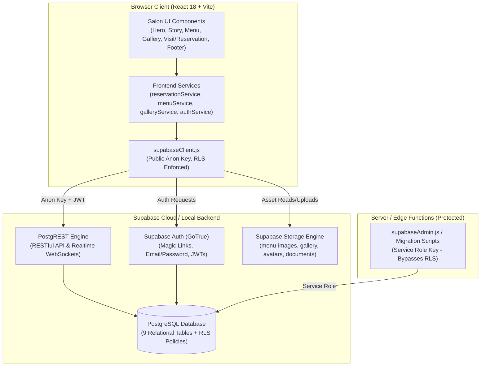
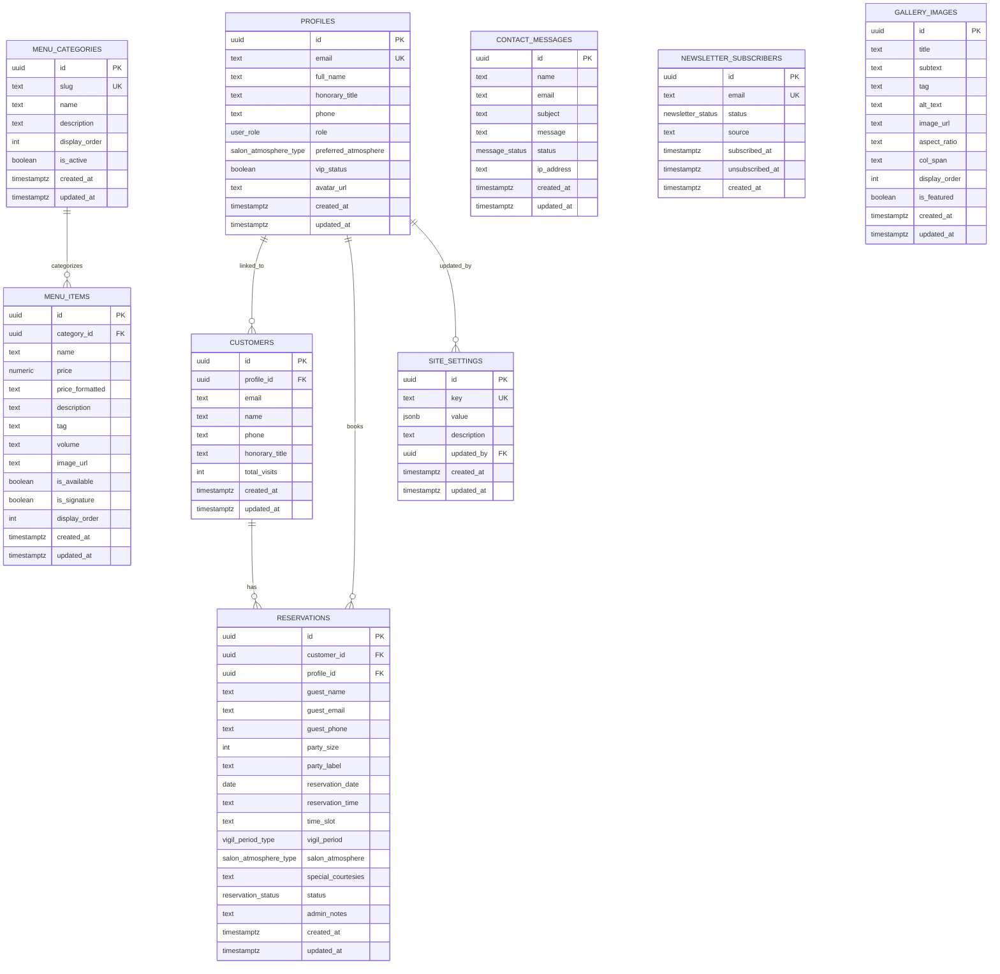

# 🏛 2 AM TO PM — Supabase Backend Architecture Plan

**Project:** 2 AM TO PM — Haute European Cafe & Salon  
**Repository:** [https://github.com/shivakshkaushik8590-dev/2AM-to-PM](https://github.com/shivakshkaushik8590-dev/2AM-to-PM)  
**Date:** November 2026  
**Status:** Backend Architecture & Migration Foundation Ready  

---

## 1. Executive Summary & Framework Identification

Following complete inspection of the project repository, the application is architected as:
- **Frontend Framework:** Client-side **React 18 Single-Page Application (SPA)**.
- **Bundler / Tooling:** **Vite 5** with `@vitejs/plugin-react`.
- **Styling Architecture:** **Tailwind CSS 3** customized with the heritage European salon aesthetic tokens defined in `DESIGN.md` (Deep British Racing Green `#00251d`, Antique Gold `#725b29`, Warm Ivory `#fef9ee`, and sharp architectural right angles `0px`).
- **Target Backend:** **Supabase (PostgreSQL 15+, GoTrue Auth, PostgREST, and Supabase Storage)**.
- **Critical Architectural Note:** The project is **not Next.js** and does not use SSR. All client queries run through the official `@supabase/supabase-js` browser client utilizing **Row Level Security (RLS)**. Secret keys (`SUPABASE_SERVICE_ROLE_KEY`) are reserved strictly for server-side scripts, migrations, or serverless Edge Functions.

---

## 2. System Architecture & Topology

---

## 3. Entity-Relationship Data Model (ERD)

The database consists of **9 core relational tables** designed with UUID primary keys, strict foreign key constraints, data validation rules, and automatic timestamp triggers:

---

## 4. Table Specifications & Data Dictionary

### 1. `profiles`
- **Purpose:** Extends `auth.users` with salon identity, honorary titles, roles, and preferred salon atmospheres.
- **Primary Key:** `id UUID` references `auth.users(id) ON DELETE CASCADE`.
- **Key Columns:** `email` (TEXT), `full_name` (TEXT), `honorary_title` (TEXT, e.g. "Lord Harrington", "Baroness"), `role` (`user_role`: `'guest'`, `'member'`, `'staff'`, `'admin'`), `vip_status` (BOOLEAN).
- **Automation:** An `AFTER INSERT ON auth.users` trigger (`handle_new_user`) creates this profile automatically upon authentication.

### 2. `customers`
- **Purpose:** CRM guest register. Enables unauthenticated visitors to book tables without mandating an immediate account, while allowing subsequent account linking.
- **Primary Key:** `id UUID DEFAULT gen_random_uuid()`.
- **Key Columns:** `profile_id` (FK nullable), `email` (TEXT indexed), `name` (TEXT), `phone` (TEXT), `total_visits` (INT).

### 3. `reservations`
- **Purpose:** Core table booking system for the continuous 22-hour vigil cycle.
- **Primary Key:** `id UUID DEFAULT gen_random_uuid()`.
- **Key Columns:**
  - `guest_name`, `guest_email`, `guest_phone`
  - `party_size` (INT, 1–24), `party_label` (e.g. "2 Guests", "Private Alcove (6+)")
  - `reservation_date` (DATE)
  - `reservation_time` (TEXT) & `time_slot` (e.g. "10:00 PM (Nocturne)", "02:30 AM (Vigil)")
  - `vigil_period` (`vigil_period_type`: `'vigil'`, `'grand_day'`, `'nocturne'`)
  - `salon_atmosphere` (`salon_atmosphere_type`: `'Main Marble Hall'`, `'Library Privé'`)
  - `special_courtesies` (TEXT)
  - `status` (`reservation_status`: `'pending'`, `'confirmed'`, `'seated'`, `'completed'`, `'cancelled'`)
- **Indexes:** Composite `(reservation_date, reservation_time)`, `status`, `guest_email`.

### 4. `menu_categories`
- **Purpose:** Categorization for the Grand Folio (`coffee`, `patisserie`, `libations`, `cellar`).
- **Columns:** `id`, `slug` (unique), `name`, `description`, `display_order`, `is_active`.

### 5. `menu_items`
- **Purpose:** Individual offerings with pricing in Euros, portion volume, extraction tag, and imagery.
- **Columns:** `id`, `category_id` (FK), `name`, `price` (NUMERIC(10,2)), `price_formatted` (e.g. "€5.50"), `tag` (e.g. "Manual Piston", "Velveteen"), `volume` (e.g. "30ml"), `is_available`, `display_order`.

### 6. `contact_messages`
- **Purpose:** Direct correspondence received for the salon concierge and maître d'hôtel.
- **Columns:** `id`, `name`, `email`, `subject`, `message`, `status` (`'unread'`, `'read'`, `'archived'`, `'replied'`).

### 7. `newsletter_subscribers`
- **Purpose:** Dispatches for the Salon Bulletin on seasonal vintages and midnight literary salons.
- **Columns:** `id`, `email` (unique), `status` (`'subscribed'`, `'unsubscribed'`), `source`, timestamps.

### 8. `gallery_images`
- **Purpose:** Archival imagery for the 12-column asymmetric Parisian gallery.
- **Columns:** `id`, `title`, `subtext`, `tag`, `alt_text`, `image_url`, `aspect_ratio`, `col_span`, `display_order`, `is_featured`.

### 9. `site_settings`
- **Purpose:** Centralized JSONB configuration for salon hours, Paris & London addresses, and concierge hotline numbers.
- **Columns:** `id`, `key` (unique), `value` (JSONB), `description`, `updated_by`.

---

## 5. Security Architecture & Row Level Security (RLS) Matrix

Row Level Security is enabled on **100% of tables**. The matrix below details permitted operations:

| Table | Anonymous Public (`anon`) | Authenticated Patron (`authenticated`) | Salon Staff / Concierge (`staff`) | Salon Administrator (`admin`) |
| :--- | :--- | :--- | :--- | :--- |
| **`profiles`** | None | Read/Update own profile | Read all profiles | Full CRUD & Role assignment |
| **`customers`** | Insert (via booking) | Read/Insert own records | Read/Update all customers | Full CRUD |
| **`reservations`** | Insert (`status = 'pending'`, future date) | Read own reservations | Read & Update status (`confirmed`, `seated`) | Full CRUD |
| **`menu_categories`** | Read (`is_active = true`) | Read (`is_active = true`) | Full CRUD | Full CRUD |
| **`menu_items`** | Read (`is_available = true`) | Read (`is_available = true`) | Full CRUD | Full CRUD |
| **`contact_messages`** | Insert | Insert | Read & Update status | Full CRUD |
| **`newsletter_subscribers`** | Insert/Update own email | Insert/Update own email | Read all | Full CRUD |
| **`gallery_images`** | Read (`is_featured = true`) | Read (`is_featured = true`) | Full CRUD | Full CRUD |
| **`site_settings`** | Read all | Read all | Read all | Full CRUD |

### Security Guardrails
1. **No Service Key in Client Bundles:** The Vite build is shielded; client code only accesses `VITE_SUPABASE_ANON_KEY`.
2. **PostgreSQL Validation Checks:** Regular expressions validate email formats on write (`email ~* '^[A-Za-z0-9._%+-]+@[A-Za-z0-9.-]+\.[A-Za-z]{2,}$'`).
3. **Capacity Constraints:** `party_size` is strictly capped between 1 and 24 covers.
4. **Self-Promotion Prevention:** Patrons updating their profile row are restricted from modifying the `role` column through RLS `WITH CHECK` conditions.

---

## 6. Storage Buckets Architecture

Four dedicated Supabase storage buckets are configured:

1. **`menu-images` (Public):**
   - High-resolution photography of coffees, pastries, and signature cocktails.
   - Max file size: 5 MB. Allowed MIME types: JPEG, PNG, WebP, AVIF.
2. **`gallery` (Public):**
   - High-fidelity archival imagery of the Parisian salon, Carrara marble tables, and lever piston machines.
   - Max file size: 10 MB.
3. **`avatars` (Public Read / Authenticated Write):**
   - Patron and dignitary profile emblems. Path structure: `avatars/{userId}/profile.jpg`.
   - Max file size: 2 MB.
4. **`documents` (Private):**
   - Wine lists, private event folios, and sommelier reserve manifests.
   - Access restricted to staff and admins.

---

## 7. Migration Sequence

The SQL migration files reside in [`supabase/migrations/`](file:///c:/Users/shiva/Downloads/stitch_2am_to_pm_luxury_cafe/supabase/migrations):

1. [`20261104000001_initial_schema.sql`](file:///c:/Users/shiva/Downloads/stitch_2am_to_pm_luxury_cafe/supabase/migrations/20261104000001_initial_schema.sql): Enums, tables, triggers, and foreign keys.
2. [`20261104000002_rls_and_security.sql`](file:///c:/Users/shiva/Downloads/stitch_2am_to_pm_luxury_cafe/supabase/migrations/20261104000002_rls_and_security.sql): Helper functions, RLS policies, and storage bucket security.
3. [`20261104000003_seed_data.sql`](file:///c:/Users/shiva/Downloads/stitch_2am_to_pm_luxury_cafe/supabase/migrations/20261104000003_seed_data.sql): Initial brand catalogue, prices, gallery photography, and schedules.

